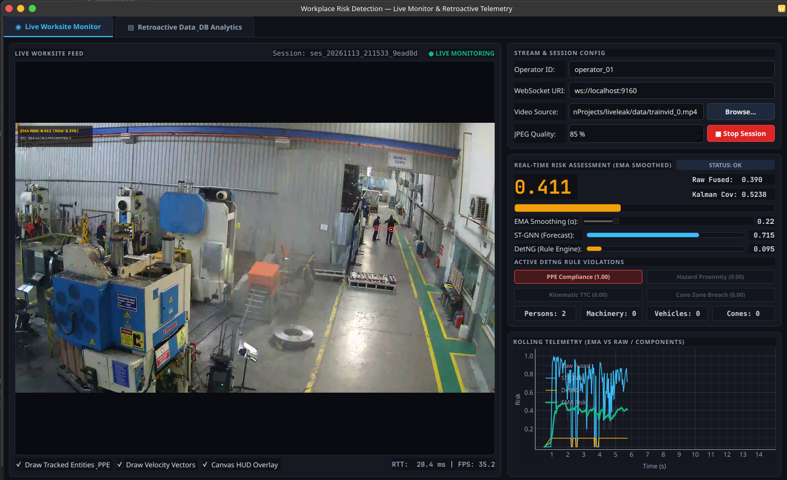
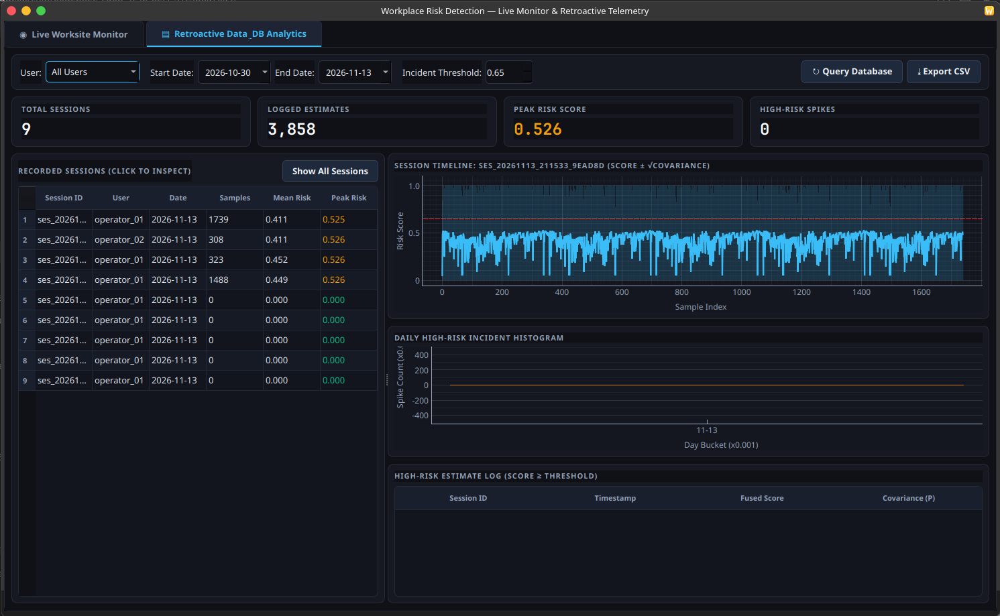
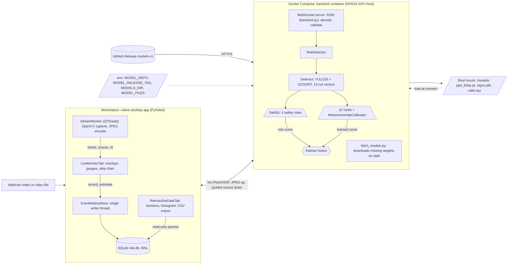

# liveleak: Workplace Risk Detection

Computer-vision safety monitoring for construction sites. A desktop app streams camera or video frames to a GPU
inference backend that detects people, PPE, machinery, vehicles and safety cones, tracks them, and produces a
continuously updated risk estimate. Built for COMP 425 (Software Engineering), Milestone 4.



## What it does

1. **Detect and track.** YOLO26 finds people, PPE (hardhat, mask, vest), machinery, vehicles and cones. OCSORT keeps
   object IDs across frames.
2. **Score two ways.** `DetNG` evaluates four deterministic safety rules. An ST-GNN forecasts each object's motion, and
   a calibrator turns the forecast error into a 0 to 1 anomaly score.
3. **Fuse.** A Kalman filter combines both scores into one fused risk plus a covariance, so you can see which source
   drives it.
4. **Display and save.** The desktop app draws boxes, IDs and PPE status, shows the live risk, and saves every estimate
   to SQLite. The Retroactive tab reloads past sessions with a timeline, a daily high-risk histogram, an incident log
   and CSV export.

The fused score is an uncalibrated risk signal. It has not been validated as the probability of an accident.



## Team

| Member         | Area                                                                       |
|----------------|----------------------------------------------------------------------------|
| Gabriel Garcia | Rule engine (DetNG), Kalman fusion, integration, desktop app, SQLite store |
| Ambar Pichardo | ST-GNN and calibrator, PyTorch container                                   |
| Alvin Almonte  | CI/CD, Docker Compose, model delivery, deployment                          |
| Lewdys Aquino  | YOLO detection, UI, diagrams                                               |

Instructor: Dr. Mohammad Shahab

## Architecture

Two parts: a **backend** in Docker (WebSocket inference service on port 5020) and a **desktop app** that runs natively
on the workstation and talks to it.



Diagram sources are in [`docs/diagrams/`](docs/diagrams/) (`container.mermaid` and `sequence.mermaid` show the system as
built). Module contracts and known issues are in [`docs/SSOT.md`](docs/SSOT.md).

## Run it

### 1. Backend (Docker)

Requires Docker, an NVIDIA GPU with a CUDA 13-compatible driver, and
the [NVIDIA Container Toolkit](https://docs.nvidia.com/datacenter/cloud-native/container-toolkit/latest/install-guide.html).

```sh
git clone https://github.com/ggarciabaez/liveleak
cd liveleak
cp .env.example .env
docker compose up --build
```

- There is no web page. The service listens on **`ws://localhost:5020`**.
- On first start it downloads the model files (`ppe_50ep.pt`, `stgnn.pth`, `calib.npz`) from the GitHub Release
  `models-v1` into `./models` and reuses them afterwards.
- Stop it with `Ctrl+C`, then `docker compose down`.
- No GPU? Build the CPU image instead (see [`docs/DOCKER.md`](docs/DOCKER.md)):
  ```sh
  docker build -t workplace-risk:cpu .
  docker run --rm -p 127.0.0.1:5020:5020 -v "$(pwd)/models:/models" workplace-risk:cpu
  ```

Configuration is in `.env` (copy of `.env.example`; never committed):

| Variable            | Default                           | Purpose                                                |
|---------------------|-----------------------------------|--------------------------------------------------------|
| `MODEL_REPO`        | `ggarciabaez/liveleak`            | GitHub repo hosting the model release (must be public) |
| `MODEL_RELEASE_TAG` | `models-v1`                       | Release tag to download from                           |
| `MODELS_DIR`        | `/models`                         | Where the container looks for weights                  |
| `MODEL_FILES`       | `ppe_50ep.pt,stgnn.pth,calib.npz` | Files to fetch and load, in this order                 |

### 2. Desktop app

Python 3.12 or newer and [uv](https://docs.astral.sh/uv/).

```sh
uv sync
uv pip install PySide6 pyqtgraph
python -m app.app
```

In the **Live Monitor** tab keep the URI `ws://localhost:5020`, set the source to `0` (webcam) or a video file path,
enter an operator name, and press **Start Session**. Press it again to stop. Open the **Retroactive** tab to review
saved sessions. Defaults are in [`app/config.toml`](app/config.toml); estimates are saved to `risk.db` in the folder you
launch from.

## Test it

```sh
uv run pytest -q                                                  # unit, contract and API tests
uv run --no-project --with ruff ruff check --isolated tests       # lint (same as CI)
python scripts/smoke_backend.py                                   # smoke test, needs the backend running
```

- **Unit and contract tests** cover DetNG rules, detector utilities, the Kalman filter, the ST-GNN and calibrator, and
  cross-module handoffs.
- **API tests** (`tests/api_test.py`) start a real local WebSocket server with a stub model, so they need no GPU or
  weights. They cover a valid frame, base64 input, malformed and empty input, frames with no detections, and missing
  model files.
- **Smoke test** (`scripts/smoke_backend.py`) connects to the running container, sends a valid frame, sends bad bytes,
  and checks the backend still responds. It exits 0 on pass. Use `--uri` for another address.
- CI (`.github/workflows/ci.yml`) runs lint and the pytest suite with coverage on every pull request and push to `main`.
- Manual scenarios: [`docs/manual-tests.md`](docs/manual-tests.md).

## Backend protocol

Send one JPEG or PNG per WebSocket message (raw bytes or base64 text, up to 16 MiB), one connection per camera. The
server replies with one pickled dictionary per frame containing `rule_score`, `model_score`, `fused_score`,
`model_unavailable_reason` and a `results` block. Scores are `None` during warmup or when there are no detections
(reason `no_detections`). An invalid frame returns `{"error": ...}`. Only unpickle replies from a server you trust.
Details are in [`docs/DOCKER.md`](docs/DOCKER.md).

## Project structure

```
.
├── app/                 Desktop app (PySide6)
│   ├── app.py           Live Monitor and Retroactive tabs
│   ├── worker.py        Capture + WebSocket streaming thread
│   ├── db.py            SQLite EventHistoryStore (USER, SESSION, RISK_ESTIMATE)
│   └── config.toml      App defaults
├── backend/             Inference service (runs in Docker)
│   ├── backend.py       WebSocket server and frame validation
│   └── fetch_models.py  Downloads model files from the GitHub Release
├── modules/             Risk pipeline
│   ├── Detector.py      YOLO + OCSORT, 13-column feature vectors
│   ├── detng.py         Deterministic safety rules
│   ├── stgnn.py         ST-GNN and motion-anomaly calibrator
│   ├── kfilter.py       Kalman fusion
│   └── risk.py          RiskDetector: ties the pipeline together
├── tests/               pytest suite (unit, contract, API)
├── scripts/             smoke_backend.py, dataset and training tools
├── docs/                SSOT.md, DOCKER.md, diagrams/, images/
├── Dockerfile           Backend image (cpu or gpu build arg)
├── compose.yaml         Backend service
├── .env.example         Environment variable template
└── .github/workflows/   CI
```

`sandbox/` holds experiments and is not part of the app. Model weights are never committed; they come from the GitHub
Release.
